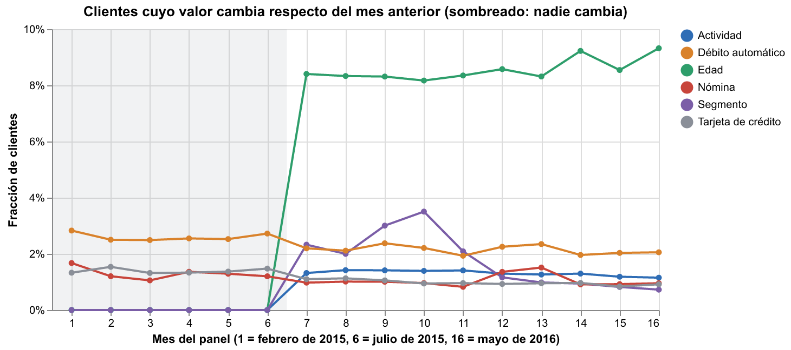
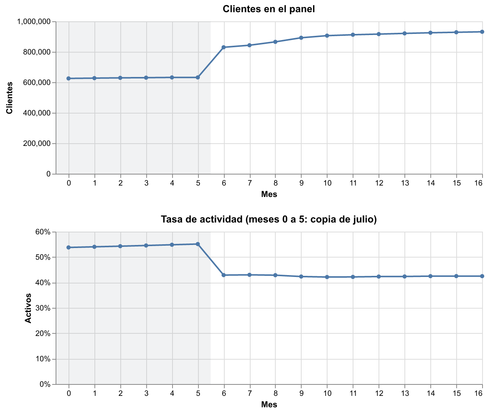
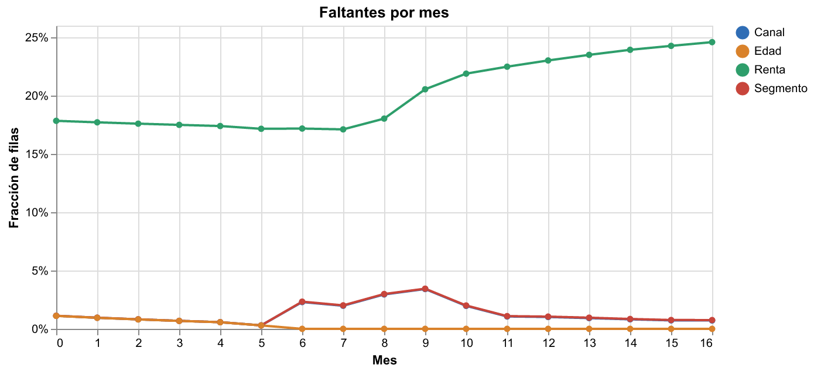

# Hito 1: datos, calidad y diseños

[← Volver a la portada](index.md)

## Los datos

Santander Product Recommendation: **13.647.309 filas**, **956.645 clientes** y 17 meses
(enero de 2015 a mayo de 2016), sin duplicados cliente-mes. Cada fila trae demografía,
segmento, canal de vinculación, un indicador de actividad y la tenencia de 24 productos.

El CSV mezcla tipos dentro de una columna (`indrel_1mes` trae `1` y `1.0`; `age` y
`antiguedad` traen espacios y `NA`; la antigüedad usa `-999999` como faltante). Se lee todo
como texto y se tipa en un solo lugar. La codificación es UTF-8 válida.

## Tres hallazgos que cambian el diseño

**1. De enero a julio de 2015 la demografía y la actividad están congeladas.** Ningún
cliente cambia de actividad, antigüedad, edad ni segmento entre los meses 0 y 6, mientras que
los productos sí cambian todos los meses. La antigüedad de enero va seis meses adelantada
respecto de la fecha de alta: es una copia de julio pegada hacia atrás.

Consecuencia: usar la actividad de esos meses como "pasado" sería usar el futuro. **Toda
variable que no sea un producto se toma desde julio de 2015 (mes 6).**

**2. En julio de 2015 entran al panel 193.115 clientes**, pero solo 16.708 se dieron de alta
ese mes: el resto ya eran clientes. La tasa de actividad cae de 55 % a 43 % por composición,
no por comportamiento.

**3. Registro tardío de los clientes nuevos.** En el mes de alta faltan el canal (99 %) y el
segmento (100 %); aparecen al mes siguiente. Para el canal se toman de alta+1.

## Otras inconsistencias

| Problema | Filas o clientes |
|---|---|
| Filas sin demografía (solo enero a junio de 2015) | 27.734 filas, 7.340 clientes |
| La edad disminuye de un mes al siguiente | 22.682 filas |
| Fecha de alta posterior al mes del dato | 11.586 filas |
| Marcado como fallecido y activo | 16.307 filas |
| Menores de 18 años / con nómina | 118.796 / 57 filas |
| Mayores de 100 años | 12.869 filas |
| Clientes que cambian de segmento | 25.386 |
| Pensión sin nómina (la nómina siempre trae pensión) | 64.124 filas |

La renta falta en el 18 % de las filas en enero de 2015 y en el 25 % en mayo de 2016, y nunca
cambia para un mismo cliente.

## Diseños causales

Cada pregunta se arma como una **emulación de ensayo objetivo** mes a mes: en cada mes `t`,
los elegibles que inician el tratamiento contra los que no lo inician en `t` (aunque lo hagan
después: efecto de intención de tratar). Covariables en `t-1` o antes; resultados en `t+3`.

| Pregunta | Tratamiento | Resultado | Tratados |
|---|---|---|---|
| Nómina | Inicia la nómina (sin nómina en los 3 meses previos) | Activo en t+3; cambio en otros productos | 9.723 |
| Canal | Alta por KHM frente a KHN | Meses activo en los 6 meses siguientes | 8.842 frente a 4.480 |
| Débito automático | Adquiere débito automático, estando activo | Inactivo en t+3 | 20.547 |
| Tarjeta de crédito | Adquiere tarjeta, estando activo | Inactivo en t+3 | 9.148 |
| Cuenta electrónica | Adquiere cuenta electrónica, estando activo | Inactivo en t+3 | 6.645 |

Cada diseño tiene un **placebo de adelanto**: clientes que inician el tratamiento cuatro meses
después, comparados en un resultado medido antes de que lo inicien. Su efecto verdadero es
cero; si no lo es, el diseño no separa la causa de la selección (por ejemplo, "los más
activos traen la nómina").

En este hito **no se cruzó ningún tratamiento con ningún resultado**: los diseños quedan
definidos antes de mirar efectos y se fijan en el [preregistro](preregistro.md).
