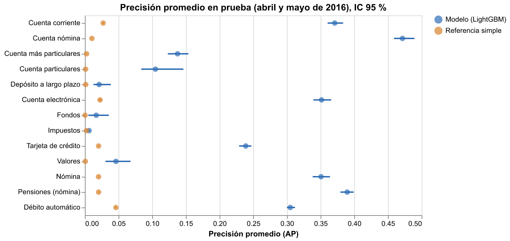
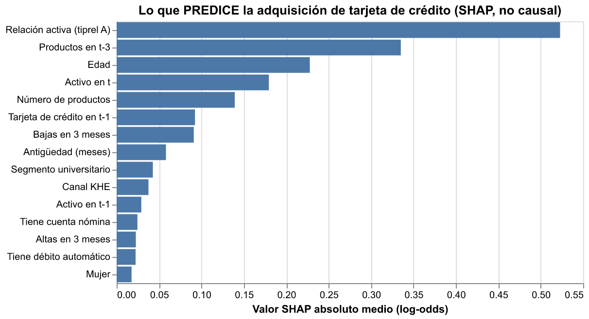

# Hito 2: capa predictiva

[← Volver a la portada](index.md)

**Pregunta:** ¿quién va a adquirir cada producto el mes que viene? Es una pregunta de
**predicción**: sirve para decidir a quién mostrarle una oferta, no para saber qué la causa.

## Cómo se evaluó

- Una fila por cliente y mes `t` (julio de 2015 a abril de 2016: solo meses con demografía
  real). La etiqueta de un producto vale 1 si el cliente no lo tenía en `t` y lo tiene en
  `t+1`.
- Partición temporal: entrenamiento con `t` = julio a diciembre de 2015, validación con enero
  y febrero de 2016. Ahí se eligieron los productos, la configuración de LightGBM y las rondas.
- Parámetros congelados con el tag `hito2-congelado`. Reentrenamiento con julio de 2015 a
  febrero de 2016 y **una sola medición en prueba**: adquisiciones de abril y mayo de 2016.
- Referencia simple: la tasa de adquisición de cada producto por segmento, tramo de edad y
  actividad.
- Métricas: precisión promedio (AP) por producto, con IC por bootstrap, y MAP@7 por cliente
  (la métrica de la competencia). Nunca exactitud: con 1 % de positivos, decir "nadie
  compra" acierta el 99 %.

## Resultados en prueba

| Producto | AP modelo (IC 95 %) | AP referencia | Adquisiciones en prueba |
|---|---|---|---|
| Cuenta nómina | 0,472 (0,459 a 0,489) | 0,010 | 4.727 |
| Pensiones (nómina) | 0,389 (0,379 a 0,399) | 0,020 | 9.937 |
| Cuenta corriente | 0,371 (0,360 a 0,383) | 0,027 | 7.881 |
| Cuenta electrónica | 0,351 (0,339 a 0,366) | 0,023 | 4.958 |
| Nómina | 0,351 (0,338 a 0,364) | 0,020 | 9.278 |
| Débito automático | 0,305 (0,300 a 0,312) | 0,046 | 19.962 |
| Tarjeta de crédito | 0,239 (0,229 a 0,247) | 0,020 | 8.348 |

**MAP@7:** 0,856 con el modelo frente a 0,700 con la referencia, sobre los 54.213
clientes-mes con al menos una adquisición. Los productos raros (fondos, valores, depósitos a
largo plazo, impuestos) quedan con AP menor a 0,05; el detalle está en
[metricas.json](resultados/hito2/metricas.json).

## Lo que predice (y lo que no dice)

En los cuatro productos que se contrastan con la capa causal (nómina, débito automático,
tarjeta de crédito y cuenta electrónica), las variables que más pesan son la **actividad**
del cliente y su **relación activa** (`tiprel_1mes = A`): el cliente activo es el que compra.
En la nómina pesa también haberla tenido el mes anterior: muchas nóminas van y vienen.

> **Esto no es causalidad.** Que la actividad prediga la adquisición no dice si adquirir un
> producto vuelve más activo al cliente, ni si ser activo lleva a adquirirlo, ni si ambas
> cosas tienen una causa común. Esa es la pregunta del [hito 4](hito4.md), que va en la
> dirección contraria: ¿adquirir el producto cambia la actividad?

Gráficos de las demás importancias: [nómina](resultados/hito2/shap_nomina.png),
[débito automático](resultados/hito2/shap_recibo.png),
[cuenta electrónica](resultados/hito2/shap_ecue.png).
