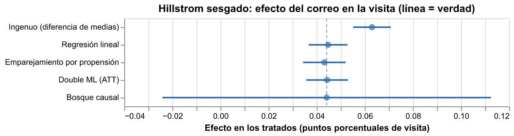
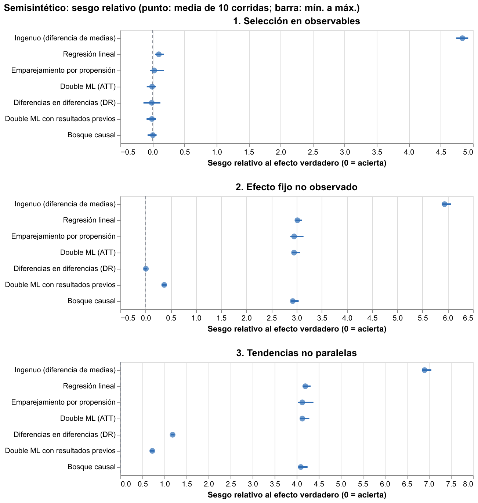

# Hito 3: validar los métodos donde se conoce la respuesta

[← Volver a la portada](index.md)

En Santander no hay verdad causal. Antes de creerle a un método allí, se prueba donde la
respuesta se conoce: un experimento real (Hillstrom) y un semisintético con efectos
inyectados sobre las covariables reales de Santander. Nada de este hito mira resultados
reales de Santander.

## Hillstrom: un experimento de verdad

64.000 clientes asignados al azar a un correo de mujer, uno de hombre o ninguno. Como la
asignación es aleatoria, la diferencia de medias es la verdad.

**Experimento completo.** Todos los métodos reproducen la verdad, como debe ser:

| Brazo y resultado | Verdad (IC 95 %) | Emparejamiento | Double ML | Bosque causal |
|---|---|---|---|---|
| Correo de mujer, visita | 0,0452 (0,0389 a 0,0516) | 0,0455 | 0,0444 | 0,0448 |
| Correo de hombre, visita | 0,0766 (0,0700 a 0,0832) | 0,0764 | 0,0757 | 0,0748 |

**Experimento sesgado.** Para imitar datos observacionales se conservan todos los controles y
cada tratado con una probabilidad conocida que sube con la historia de compra y baja con la
recencia: el correo "llega" sobre todo a los buenos clientes. El efecto verdadero en esos
tratados es **0,0441** (IC 0,0365 a 0,0517), calculado con el experimento completo. En 10
sorteos:

| Método | Sesgo relativo | Cobertura del IC 95 % |
|---|---|---|
| Ingenuo | +43 % | 0 de 10 |
| Regresión lineal | +1 % | 10 de 10 |
| Emparejamiento | −2 % | 10 de 10 |
| Double ML (ATT) | +0 % | 10 de 10 |
| Bosque causal | +0 % | 10 de 10 |

El ingenuo atribuye al correo lo que es de los buenos clientes. Ajustar por las covariables
que determinan la selección lo corrige.

## Semisintético: tres formas de equivocarse

Sobre 50.000 filas reales del diseño de la nómina (edad, actividad, tenencia, segmento...) se
simulan el tratamiento y el resultado con funciones conocidas, en tres escenarios y 10
repeticiones:

1. **Selección en observables:** quién se trata depende de la actividad, la tenencia y la
   edad. Resultado binario.
2. **Efecto fijo no observado:** además, un rasgo oculto del cliente sube la probabilidad de
   tratarse y el nivel del resultado, igual antes y después.
3. **Tendencias no paralelas:** el rasgo oculto también cambia la tendencia del resultado.

| Método | 1. Observables | 2. Efecto fijo | 3. Tendencias |
|---|---|---|---|
| Ingenuo | +484 % | +594 % | +690 % |
| Double ML (ATT) | −0 % | +295 % | +413 % |
| Double ML con resultados previos | −1 % | +37 % | +72 % |
| Diferencias en diferencias (DR) | −1 % | +1 % | +118 % |
| Bosque causal | +1 % | +292 % | +409 % |

Cobertura del IC de Double ML en el escenario 1: 10 de 10. El bosque causal ordena bien a
los clientes por su efecto (correlación de 0,76 entre el efecto condicional estimado y el
verdadero) cuando no hay confusión oculta.

**El placebo funciona.** Con dos períodos previos, una diferencia en diferencias entre ellos
(donde el efecto verdadero es cero) rechaza el cero en 10 de 10 repeticiones del escenario 3,
en 1 de 10 del escenario 2 y en 0 de 10 del escenario 1.

## Qué se lleva a Santander

- Ningún método salva una confusión oculta que cambia la tendencia. Lo que sí se puede hacer
  es **detectarla**: por eso cada diseño de Santander tiene un placebo de adelanto.
- Agregar los resultados previos como covariables (lo que hacen los diseños de Santander)
  reduce mucho el sesgo de un efecto fijo, sin eliminarlo; diferencias en diferencias lo
  elimina si las tendencias son paralelas. Por eso se reportan los dos: si coinciden, el
  efecto es más creíble.
- Estimador principal: **Double ML del ATT**, con el menor error en los escenarios donde hay
  identificación. El IC del bosque causal es conservador (el de EconML promedia los errores
  individuales), así que se usa para la heterogeneidad, no como cifra principal.

Todo esto quedó fijado en el [preregistro](preregistro.md) antes de estimar en Santander.
