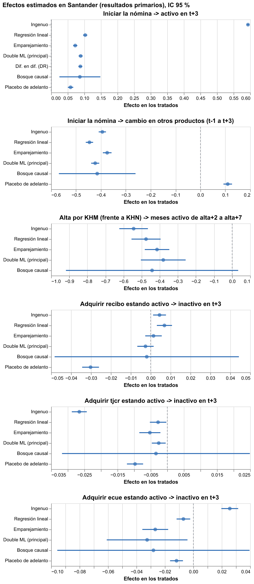
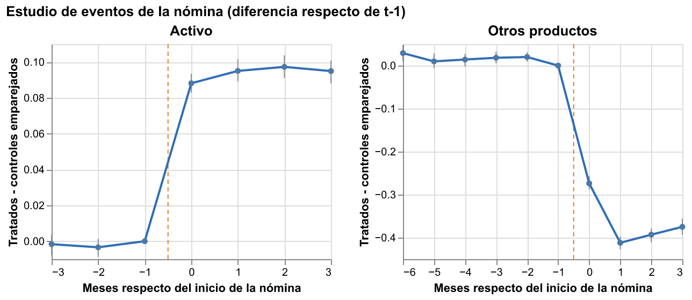

# Hito 4: efectos causales en Santander

[← Volver a la portada](index.md) · [Preregistro](preregistro.md) ·
[Estimaciones en JSON](resultados/hito4/estimaciones.json)

Todo lo de esta página siguió el [preregistro](preregistro.md) (tag `preregistro`): mismas
preguntas, ventanas, covariables, métodos y criterios. El código con huella no cambió después
del tag. Lo que no estaba preregistrado se marca como **exploratorio**.

## Veredictos

| Pregunta (resultado primario) | Efecto en los tratados (IC 95 %) | Placebo de adelanto | Veredicto |
|---|---|---|---|
| Iniciar la nómina -> activo en t+3 | +0,089 (0,083 a 0,095) | +0,058 | no separable de la selección |
| Iniciar la nómina -> otros productos | −0,423 (−0,439 a −0,407) | +0,110 | no separable de la selección |
| Alta por KHM (frente a KHN) -> meses activo | −0,38 (−0,50 a −0,26) | no aplica | creíble |
| Débito automático -> inactivo en t+3 | −0,0026 (−0,0067 a 0,0015) | −0,030 | sin efecto detectable |
| Tarjeta de crédito -> inactivo en t+3 | −0,0026 (−0,0047 a −0,0005) | −0,010 | no separable de la selección |
| Cuenta electrónica -> inactivo en t+3 | −0,0325 (−0,0609 a −0,0041) | −0,012 | no separable de la selección |

Efectos en proporción de clientes (0,089 = 8,9 puntos porcentuales), salvo productos (número)
y canal (meses de 6). Estimador principal: Double ML del ATT. Los p-valores de Holm sobre los
seis primarios están en el JSON.

## 1. ¿La nómina vuelve más activo al cliente, o los activos la traen?

**Sobre todo, los activos la traen.** Los clientes que inician la nómina están 8,9 puntos más
activos tres meses después que clientes parecidos que no la iniciaron. Los cinco métodos
coinciden (emparejamiento 0,073, diferencias en diferencias 0,088, bosque causal 0,087) y los
tres refutadores de DoWhy pasan. El ingenuo, sin ajustar, da 0,593: casi todo era selección
visible.

Pero el placebo lo desarma: clientes que iniciarán la nómina **cuatro meses después**,
comparados con clientes parecidos, ya están **5,8 puntos más activos** antes de traerla. Dos
tercios del "efecto" aparecen sin nómina: los clientes que se están volviendo más activos son
los que después traen la nómina. Con eso, el criterio preregistrado declara el efecto **no
separable de la selección**.

Dos cautelas más: el salto de actividad es inmediato (mes 0), compatible con que el abono de la
nómina cuente como "actividad" por definición; y la tendencia previa plana en el gráfico es en
parte de construcción (la actividad de t-1 a t-3 se empareja).

**La caída de otros productos es un artefacto de definición** (análisis exploratorio, no
preregistrado). Al iniciar la nómina, el 51 % de los clientes cambia su **cuenta corriente
por la cuenta nómina**: la cuenta corriente baja 0,52 por cliente frente a los controles. El
preregistro excluyó la cuenta nómina de "otros productos" pero no previó este reemplazo. Sin la
cuenta corriente, el cambio es **+0,149** (0,136 a 0,161), con el débito automático a la cabeza
(+0,075 sin ajuste); pero el placebo da +0,094: otra vez, la mayor parte ya estaba en marcha.

## 2. ¿El canal de vinculación cambia cuánto tiempo sigue activo el cliente?

**Sí, y el resultado pasa todas las pruebas aplicables.** Los clientes que entraron por KHM
estuvieron activos **0,38 meses menos** (de 6) que clientes comparables que entraron por KHN
(media de los de KHM: 4,38 meses), y 6,0 puntos menos activos en el séptimo mes. Emparejamiento,
Double ML y bosque causal coinciden, los refutadores pasan y un confusor omitido tendría que ser
mucho más fuerte que cualquier covariable observada para anularlo (valor de robustez 0,076
frente a R² parciales de 0,005 a 0,008).

Límites: aquí no hay placebo de adelanto (el canal se fija al entrar); los códigos de canal
están anonimizados, así que no se sabe qué canal es cuál; y "creíble" quiere decir "pasó las
pruebas", no "demostrado".

**Exploratorio:** KHQ frente a KHM en jóvenes da −2,4 meses, pero el preregistro ya lo había
marcado sin interpretación causal: el 86 % de los tratados por KHQ tiene propensión mayor que
0,95. Casi no hay jóvenes comparables en KHM.

## 3. ¿Qué productos frenan el paso de activo a inactivo?

**Ninguno de los tres, con credibilidad.** Entre clientes activos, pasar a inactivo en tres
meses es raro (0,8 % de quienes adquieren tarjeta, 4,5 % de quienes adquieren débito, 6,1 % de
quienes adquieren cuenta electrónica).

- **Débito automático:** sin efecto detectable (−0,003, IC incluye el cero).
- **Tarjeta de crédito:** −0,3 puntos, pero el placebo es casi cuatro veces mayor (−1,0): quienes
  adquirirán la tarjeta ya se desactivan menos antes de tenerla.
- **Cuenta electrónica:** −3,3 puntos, pero el placebo es −1,2 (36 % del efecto, por encima
  del 25 % permitido) y la sensibilidad es frágil: un confusor omitido con R² parcial de 0,002
  bastaría para que el IC incluya el cero. En el resultado secundario (inactivo en t+1) pasa
  el placebo, pero sigue siendo sensible.

## Lo que predice contra lo que causa

En el [hito 2](hito2.md), la actividad del cliente es lo que más **predice** que adquiera un
producto. Aquí, adquirir el producto no **causa** de forma creíble más actividad: la flecha
fuerte es la contraria o una causa común. Una lista de "productos que retienen" armada con
las importancias de un modelo predictivo habría sido una lista de síntomas de clientes ya
activos. El [hito 5](hito5.md) lo mide cliente a cliente.

## Supuestos y limitaciones

- Datos observacionales: el placebo y la sensibilidad detectan confusión, no la descartan.
- La actividad no tiene definición pública y puede contar mecánicamente movimientos de la
  nómina, del débito o de la tarjeta.
- Efecto por intención de tratar a 3 meses (6 en el canal); el panel termina en mayo de 2016.
- DoWhy refuta con `LinearDML`, que estima un promedio ponderado por varianza (por ejemplo 0,144
  en nómina -> actividad) y no el ATT; sus criterios se comparan contra su propia estimación.
