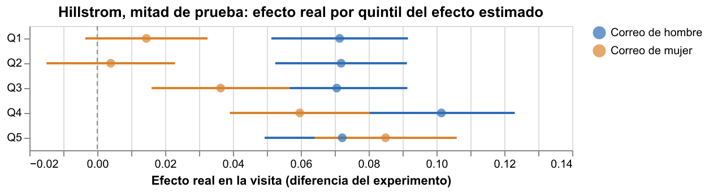
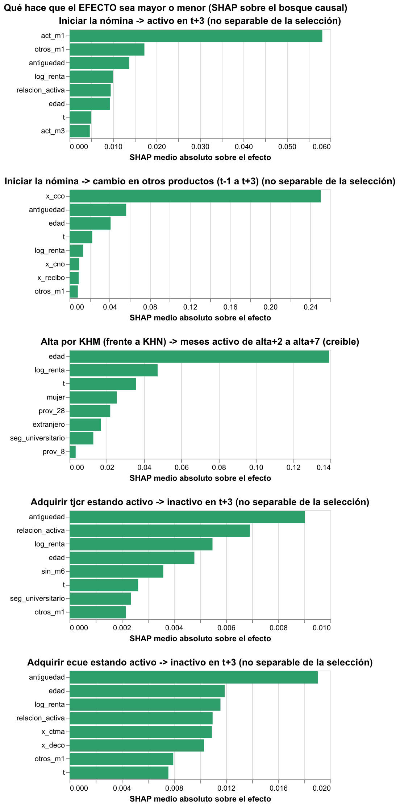

# Hito 5: a quién le cambia el resultado

[← Volver a la portada](index.md) ·
[Resultados en JSON](resultados/hito5/heterogeneidad.json) ·
[Simulador de campaña interactivo](demo.html#simulador)

Un efecto promedio esconde a quién le sirve la acción. Aquí se estima el efecto cliente a
cliente con un bosque causal, se explica con SHAP **sobre el efecto** (no sobre la
predicción) y se resume en árboles de política. Primero donde se puede comprobar (Hillstrom),
después en Santander, donde cada resultado hereda el veredicto de su pregunta en el
[hito 4](hito4.md).

## Hillstrom: la heterogeneidad se comprueba

El bosque se entrena con una mitad del experimento y se juzga en la otra, donde el sorteo
permite medir el efecto real de cada grupo.

- **Correo de mujer:** el bosque ordena bien. En el quintil con menor efecto estimado, el
  efecto real es 0,014 visitas por cliente (IC −0,004 a 0,032); en el de mayor efecto, 0,085
  (0,064 a 0,106). SHAP sobre el efecto dice por qué: funciona en quienes ya compraban ropa de
  mujer. Qini en prueba: 0,071.
- **Correo de hombre:** el efecto es parejo (entre 0,071 y 0,101 por quintil, sin orden): no
  hay heterogeneidad que aprovechar. Qini en prueba: 0,007.
- **Árbol de política** (nada, correo de hombre o de mujer; costo supuesto de 0,05 visitas por
  correo): manda correo de mujer al 24 % y de hombre al resto. Su valor neto en prueba (0,132
  visitas por cliente) **no supera** a mandarle a todos el de hombre (0,133). Es el resultado
  honesto: con un efecto tan parejo, segmentar no paga.

## Santander: qué modula el efecto (y qué no se puede creer)

- **Canal (creíble):** el efecto negativo de KHM frente a KHN se concentra en los más jóvenes
  según el bosque, pero **en la mitad independiente los quintiles no lo confirman**: el
  efecto doble robusto no crece con el efecto estimado. El promedio es creíble; su reparto,
  no. El árbol de política no encuentra a quién conviene KHM.
- **Nómina -> actividad (no separable de la selección):** todo el efecto estimado está en
  quienes estaban **inactivos** en t-1; en los ya activos es casi cero. Es lo que se espera si
  el abono de la nómina cuenta como actividad por definición: otra señal de que este efecto
  no debe leerse como "la nómina retiene".
- **Nómina -> otros productos:** lo modula tener cuenta corriente, que es la que se reemplaza
  por la cuenta nómina (el artefacto descrito en el hito 4).

## Lo que predice contra lo que causa

Para la tarjeta de crédito y la cuenta electrónica se compara, en los mismos clientes, la
**propensión a adquirir** (el modelo congelado del [hito 2](hito2.md), un mes antes) con el
**efecto estimado de adquirir** sobre la inactividad:

| Producto | Correlación de Spearman | Efecto medio en el quintil de menor propensión | En el de mayor propensión |
|---|---|---|---|
| Tarjeta de crédito | +0,30 | −1,5 pp | −0,2 pp |
| Cuenta electrónica | +0,34 | −5,0 pp | −1,9 pp |

Como un efecto negativo es "protege", la correlación positiva quiere decir que **los clientes
con más probabilidad de adquirir el producto son aquellos en quienes adquirirlo menos
cambia**. Una campaña dirigida con el modelo predictivo apuntaría justo a donde la acción
menos importa. Los árboles de política apuntan a otro lado: la tarjeta, a clientes con
menos de 55 meses de antigüedad o renta menor; la cuenta electrónica, a clientes con menos de
30 meses de antigüedad (efecto doble robusto en la mitad de prueba: −2,0 pp y −5,1 pp, frente a
−0,1 pp y −0,7 pp en los no recomendados).

> **Cautela.** Estos dos efectos fallaron el placebo de adelanto en el hito 4: no se pueden
> separar de la selección. La comparación ilustra el método y la diferencia entre las dos
> preguntas; no es una recomendación de campaña.
